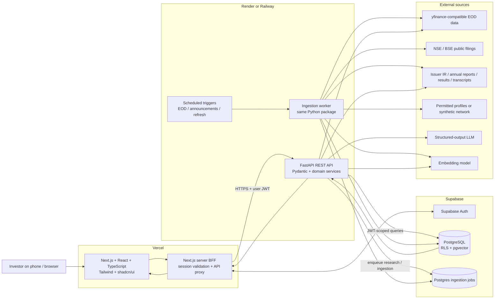

# FINN System Architecture

## Decision summary

Build a single-user/demo-first, mobile-first product with three connected workflows: Push, Pull, and contextual Network intelligence. Keep the deployable system to:

- **Next.js web frontend** on Vercel.
- **FastAPI backend** on Render (or Railway).
- **One PostgreSQL database** on Supabase, with pgvector for document retrieval.
- **One lightweight worker process** using the same Python code and PostgreSQL job table; no separate queue service.
- External source adapters for EOD market data, exchange announcements, company primary documents, and permitted/synthetic profiles.

The backend accepts arbitrary supported NSE symbols. Seed data improves the demo, but company and source resolution must not be restricted to the seed list.

## System diagram

The diagram shows logical boundaries, not a requirement for each source to have a separate service. In particular, ingestion and market adapters live in the same backend package.

## Major technology choices

| Technology | Why it fits FINN | Boundary / tradeoff |
|---|---|---|
| Next.js + React + TypeScript | Mature mobile-responsive web UI, shared type-safe frontend patterns, simple deployment on Vercel, and server-side BFF routes to keep tokens out of browser code. | Do not duplicate business rules in Next.js; the Python API remains authoritative for data, calculations, and access checks. |
| Tailwind CSS + shadcn/ui | Fast composition of a polished, consistent UI without introducing a separate design system service. | Keep components few and product-specific; avoid large component abstractions for a short prototype. |
| Recharts | Appropriate for compact, accessible trend charts and simple EOD/financial time-series. | Do not use for decorative charts that do not improve the decision flow. |
| React Flow | Used for the Network relationship workspace where a bounded interactive graph helps explain first- and second-degree paths. | Keep graph scope small and pair it with a relationship-details panel; contact search and evidence-backed cards remain usable on mobile. |
| Python + FastAPI + Pydantic | FastAPI provides typed REST/OpenAPI contracts; Python is a natural fit for PDF/text ingestion and data-source libraries; Pydantic validates LLM and API payloads. | Keep it a modular monolith, not microservices. |
| Pandas | Useful for normalizing EOD time series and calculating rolling baselines if the source returns tabular data. | Use only at the data-adapter boundary; do not make every calculation a DataFrame operation. |
| NumPy | Not needed for the P0 calculations. | Simple ratios and threshold tests should use explicit Python/Decimal logic. Add NumPy only if measured workload justifies it. |
| PostgreSQL / Supabase | Durable relational store for issuers, filings, metrics, and workspace-private relationships; Supabase offers managed Postgres and Auth. | One database is the source of truth. No separate cache, graph database, or vector database. |
| pgvector | Keeps document embeddings beside document/chunk provenance and permits filtered similarity search without another service. | Restrict retrieval by issuer, document type, and workspace policy; version the embedding model/dimension. |
| yfinance-compatible adapter | Convenient candidate for demo EOD prices/volume and arbitrary NSE ticker suffix handling. | It is not an exchange SLA or guaranteed API. Cache, label timestamps, and isolate the adapter so it can be replaced. |
| Vercel | Simple Next.js hosting and preview deployments. | Frontend only; do not run long PDF or batch jobs in serverless request handlers. |
| Render or Railway | Straightforward hosting for a long-running FastAPI service and worker process. | One region near the database; keep long work in the worker. Compare current pricing/limits before choosing. |

## Backend module boundaries

Keep one Python package with clear modules:

- `api`: FastAPI routers, auth dependency, request/response models.
- `companies`: ticker resolution, issuer aliases, exchange identifiers.
- `sources`: yfinance, exchange filing, investor-relations/document adapters.
- `ingestion`: schedules, job claiming, PDF/text extraction, normalization.
- `research`: retrieval, evidence assembly, structured LLM call and citation validation.
- `finance`: deterministic period matching, ratios, QoQ/YoY and alert calculations.
- `network`: deterministic matching/ranking and evidence paths.
- `repositories`: tenant-scoped persistence and transaction handling.

Use the same package and locked dependencies for API and worker deployments. Do not introduce a domain-event bus, Celery, Redis, Kafka, LangChain agents, or a graph database for the demo.

## Request and data flow

1. The browser uses Next.js server routes as a same-origin BFF. It does not hold a database key or call model providers directly.
2. The BFF forwards a short-lived Supabase user JWT to FastAPI over HTTPS.
3. FastAPI validates the JWT signature, issuer, audience, expiry, and subject. The API resolves the provisioned user and verifies membership for the selected workspace before private queries. Production PostgreSQL RLS remains a required defense-in-depth control and is not yet implemented.
4. Push reads normalized announcements and EOD series, applies deterministic ranking/threshold logic, and joins only the current workspace's alert preferences/network.
5. Pull resolves the requested ticker dynamically, selects primary issuer documents, retrieves relevant chunks, and builds a source-bounded evidence bundle. Deterministic calculations run in Python; an LLM may summarize the bundle into a validated schema.
6. Network matches use deterministic company/person/employer/education edges and explain the evidence. Personal relationship data is never needed for Pull's public-document retrieval.
7. Scheduled ingestion normalizes source data once, deduplicates by source identity/content hash, records freshness, and writes to Postgres. User reads do not trigger repeated bulk scraping.

## Caching and freshness policy

PostgreSQL is the durable cache and source of truth. Do not add Redis for the expected traffic. All source-derived rows retain `fetched_at`, `source`, and content/source identity. The UI shows the last successful refresh and whether data is current, delayed, or stale.

| Data | Refresh/cache policy | Freshness presentation |
|---|---|---|
| EOD close/volume | Fetch once after market close; unique key by issuer/exchange/market date/source makes retries idempotent. | Current when the latest completed exchange session is present; delayed/stale if that session's data is absent beyond the configured source window. Account for weekends and exchange holidays. |
| Announcements | Poll conservatively (initially hourly); deduplicate by exchange/source key and retain original filing URL. | Show source fetch time; mark stale when the latest poll failed or exceeds the configured polling tolerance. Do not claim real-time coverage. |
| Company documents and extracted chunks | Revalidate source links periodically or on explicit refresh; content hash controls re-extraction and re-embedding. | Display document publication period and last checked time; changed checksum triggers a new version, not silent replacement of cited content. |
| Embeddings | Cache by chunk content hash + embedding model/version. | Reuse unchanged vectors; re-embed only changed chunks or on a deliberate model migration. |
| Research synthesis | Cache by issuer + eligible document/checksum set + reporting basis + requested sections + model/prompt/schema version. Invalidate when an eligible source changes. | Return the generation time and source manifest. Never reuse a result across workspaces if it contains private context. |
| Private network matches | Compute from current workspace data; optionally cache briefly within that workspace only. | Invalidate when a profile, experience, edge, or source verification changes. Never share a match cache between tenants. |
| HTTP/browser cache | Public non-personal assets may use normal CDN caching. Digest, alert, research, and network responses use `Cache-Control: private, no-store` unless a reviewed workspace-scoped cache is added. | Prevent stale private data from persisting in shared browser/CDN caches. |

## Data pipeline rules

- **Market:** fetch daily close/volume for portfolio symbols after market close; retain market date, fetched time, exchange/ticker mapping, source, and adjustment policy. Calculate baseline volume and move thresholds in backend code.
- **Announcements:** poll accessible NSE/BSE sources conservatively; store raw filing URL and metadata before classification. Keep original issuer/category text, normalized label, model/rule confidence, and source timestamps. Low-confidence classification remains visible as `unclassified`.
- **Fundamentals:** discover annual reports, quarterly result filings, and concall transcripts from issuer IR and permitted screener links. Extract text/page references; use result filings for the four headline metrics. Preserve issuer, period, standalone/consolidated basis, units, and original source URL.
- **Network:** use synthetic records for the demo. Production data must come from the user's authorized input or a permitted source; do not scrape restricted profiles.
- **Identity:** resolve issuers by exchange/security ID and ticker aliases before names. Resolve people only with corroborating evidence (name plus role/employer/period/other attributes); keep uncertain matches unresolved for review.

## Arbitrary supported NSE ticker

`POST /api/v1/research` accepts a normalized NSE ticker or supported exchange symbol. A registry of companies and aliases is a resolution aid, not an allowlist of demo tickers. If no company record exists, the backend attempts the configured ticker/company lookup and permitted source discovery, creates/updates the canonical issuer record after validation, and proceeds only when primary documents are found. Return a clear `data_unavailable` result for unsupported/ambiguous symbols; never return a canned demo report as if it were the requested company.

Each source adapter declares its own coverage. NSE ticker syntax such as `RELIANCE` / `RELIANCE.NS` is normalized internally; BSE instruments are accepted where a valid mapping exists. Retrieval and Pull remain restricted to primary company/exchange material, not news or broker research.

## Network intelligence pipeline

1. Load only the authenticated workspace's synthetic or authorized contact records, experiences, explicit relationship edges, and source/consent labels.
2. Resolve a filing's named executive to a person only when name plus corroborating role/employer/period attributes support the match. Ambiguous identities remain unresolved.
3. Generate candidates from direct company/employer experience, related company/sector experience, customer/supplier/competitor experience when explicitly represented, education overlap, and verified one-hop/second-degree relationships.
4. Rank with transparent deterministic weights; do not describe the score as a probability or verified expertise. Prefer direct and recent evidence over looser sector/topic similarity.
5. Return the best few candidates with the exact evidence path, source label, time period, and hop count. The user can correct relationship strength or dismiss a match.
6. If no qualifying evidence exists, say there is no known match rather than inventing a contact or connection.

Network matching executes in the backend against workspace-scoped records. The LLM is not needed to rank people and does not receive private contact details.

## Explicitly removed complexity

- No React Flow in P0: relationship evidence cards satisfy the actual workflows more simply.
- No graph database: relationship paths are short, deterministic joins in Postgres.
- No Redis/Celery/Kafka: a small Postgres-backed job queue is sufficient for a prototype and one worker.
- No separate vector service: pgvector shares the existing database and provenance model.
- No always-on autonomous agent: fixed API workflows and bounded model calls are easier to audit.
- No intraday market stream: the assignment asks for EOD price/volume.
- No broad production ingestion promise: reliable supported sources plus honest missing-data states are preferable.
