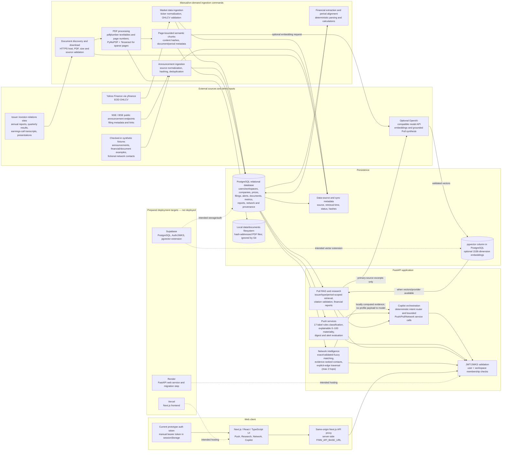

# FINN Final Architecture

## Status and evidence boundary

This document describes the implementation in the repository as reviewed on
12 November 2026. It is not a deployment claim. The Vercel, Render, and
Supabase configuration is prepared but has not been applied to provider
accounts. No authenticated production workflow or live external data feed was
verified. The exact limitations are recorded in
[KNOWN_LIMITATIONS.md](./KNOWN_LIMITATIONS.md) and
[DEPLOYMENT_PLAN.md](./DEPLOYMENT_PLAN.md).

The official challenge and reference are
[the main assignment PDF](./1.%20ENAM_Founding%20AI%20Engineer%20Build%20Challenge_Main.pdf)
and [the reference PDF](./2.%20ENAM_Build_Challenge_Reference.pdf). Their
requirements are guidance for the prototype, not proof that every example or
suggestion is implemented.

## System diagram

The deployment edges are dotted because the provider services have not been
provisioned. The database diagram shows both relational rows and vectors in
one PostgreSQL service, not a separate vector database.

## Components and request flow

### Frontend and API

- The frontend is a Next.js app with Push, Research, Network, Copilot, and
  Settings routes. Typed client modules call same-origin Next.js API proxies;
  the server-side proxy reads `FINN_API_BASE_URL` and fails explicitly when a
  production URL is missing.
- The API is a FastAPI modular monolith. Push, Pull/Research, Network, Copilot,
  and health routes share Pydantic response schemas and SQLAlchemy sessions.
- Private routes validate a bearer JWT against configured JWKS/issuer/audience,
  resolve a provisioned FINN user, and check workspace membership.
- The current browser prototype has no sign-in lifecycle. It accepts a bearer
  token through the UI and retains it in `sessionStorage`. This is a known
  prototype limitation, not a recommended production session design.

### Market data

`scripts/ingest_market_data.py` invokes the yfinance adapter for daily market
bars. It validates and normalizes OHLCV data, stores source/session metadata,
and upserts company-linked records. The service accepts a syntactically valid
supported NSE symbol; the configured 18-symbol list is a starter/demo
universe, not a universal ticker allowlist. Market movement and volume
calculations are deterministic. The volume baseline uses the preceding 20
completed sessions. Data is end-of-day, not intraday.

Refresh is manual through the ingestion command. No scheduler or background
worker is deployed. Source success, empty results, and errors are recorded
separately; source availability and rate limits remain external dependencies.

### Announcement ingestion and Push

`scripts/ingest_announcements.py` calls public NSE/BSE announcement adapters,
normalizes filing metadata and timestamps, resolves exchange symbols to
companies, hashes source payloads, and deduplicates by source identity. The
optional raw-document downloader is restricted to HTTPS exchange hosts,
PDF signatures, and a size limit. When live adapters return no records, the
pipeline may use visibly marked demo fixtures; those records are not presented
as live exchange data.

Push classification uses ordered text rules for all 17 labels in the
reference. Materiality is a deterministic 0–100 score with category,
disclosed-amount, selected adverse-signal, and portfolio-relevance terms; the
API returns score reasons and fixed priority bands. Digest filtering, results
comparisons, alert rules, and EOD threshold evaluation are backend services.
There is no autonomous continuously running alert worker.

### Documents, RAG, and financial research

Document discovery crawls bounded issuer/authorized-host pages for the four
allowed primary document types. Downloads are HTTPS/host/PDF/size validated.
PDF processing uses pdfplumber for page text and tables, retains one-based
page numbers, checks issuer/type/period, and invokes PyMuPDF plus Tesseract
only for sparse pages. A missing OCR installation produces an explicit
failure.

Chunks remain page-bounded and carry document, issuer, type, period, page,
source URL, and content hash. PDFs are stored under the local, Git-ignored
`data/documents` directory; production object storage is not implemented.
Duplicate content can reuse existing chunks and vectors. Embeddings are
optional: with a provider key, configured embeddings are validated and
persisted in the PostgreSQL pgvector column; without one, retrieval is
bounded lexical search. Both paths apply company, primary-source, document
type, period, and synthetic-data filters before ranking. Retrieval caching is
process-local.

Pull answers either return selected source quotations or, if a provider is
configured, ask the model for structured claims grounded in retrieved source
spans. The backend validates chunk IDs and exact quotes, then adds document,
period, page, URL, and synthetic status. Missing evidence is reported rather
than filled from model memory.

Financial metric, trajectory, balance-sheet, cash-flow, guidance, and period
comparison logic is deterministic Python over stored extracted metrics and
document chunks. Unit and period metadata are retained; unsupported or
missing figures remain unavailable. This does not imply that every real
issuer's financial tables are already extracted or verified.

### Network and Copilot

Contact, organization, education, employment, and explicit relationship rows
are workspace-scoped. Name and company matching normalizes strings, accepts
exact matches, and proposes fuzzy matches only above high similarity
thresholds with token checks. Candidate matches retain evidence/confidence;
they are not proof of identity. Network traversal follows explicit stored
relationship edges and is bounded to two hops. Employer/education overlap is
context for relevance, not an inferred personal connection.

Copilot classifies queries with bounded keyword/rule logic and dispatches to
existing service functions. It does not let a language model invent tool
results or run arbitrary tools. Cross-layer result blocks preserve each
service's status, evidence, and citations; current cross-layer prose is
template-generated. Network profile details are not sent to the model.

## Data stores and deployment

- **Relational store:** SQLAlchemy models and Alembic migrations define
  workspace/user ownership, entities, market and Push records, documents,
  financial results, Network relationships, reports, Copilot conversations,
  and provenance. SQLite is used for offline tests; the intended hosted
  database is PostgreSQL.
- **Vector store:** pgvector is an optional extension/column in PostgreSQL.
  It is used only when embeddings are configured and the database supports
  the extension.
- **File store:** local hash-addressed PDFs under `data/documents`; no hosted
  object-store integration is present.
- **Intended hosting:** Vercel for Next.js, Render for FastAPI, and Supabase
  for PostgreSQL/Auth/pgvector. The existing manifests are setup artifacts;
  there are no verified hosted URLs.

## Deliberate scope limits

There is no scheduled ingest worker, message queue, distributed cache,
separate vector/graph database, production contact importer, built-in login
flow, PostgreSQL RLS deployment, or intraday price feed. No real contact
profiles or report data are seeded. Those exclusions keep the prototype
focused, reduce privacy risk, and avoid representing unverified integrations
as working product features.
