# FINN Pull: document processing and grounded research

## Evidence boundary

Pull evidence is restricted to company primary documents:

- Annual reports.
- Quarterly financial results.
- Earnings-call transcripts.
- Investor presentations.

The discovery type allowlist, document ingestion service, retrieval filters, and answer API enforce this boundary. News, broker reports, research notes, secondary commentary, and synthetic seed documents are not eligible by default. Yahoo Finance may resolve a ticker and point to the issuer's website; it is not returned as evidence. Unsupported or unmapped symbols return an explicit unavailable response rather than a canned company report.

## Document lifecycle

```mermaid
flowchart LR
  Ticker[NSE ticker] --> Profile[Resolve issuer and official IR website]
  Profile --> Discovery[Bounded issuer-site discovery]
  Discovery --> Registry[(documents metadata)]
  Registry --> Download[HTTPS download from trusted issuer/CDN hosts]
  Download --> Validate[PDF signature, size, period, type and issuer]
  Validate --> Extract[Page text + detected headings + tables]
  Extract --> OCR{Insufficient text on page?}
  OCR -->|Yes| Tesseract[Optional Tesseract OCR]
  OCR -->|No| Chunk[Page-bounded semantic chunks]
  Tesseract --> Chunk
  Chunk --> Embed[Configured embedding API]
  Chunk --> Persist[(document_chunks)]
  Embed --> Persist
  Persist --> Retrieve[Issuer/type/period-filtered retrieval]
  Retrieve --> Ground[Structured, citation-validated answer]
```



### Discovery and issuer mapping

`CompanyDocumentDiscoveryService` crawls a bounded set of HTTPS issuer pages, identifies supported document types from link labels and paths, and retains the original URL, discovery page, source hostname, ticker, and fetch time. A configured `FINN_DOCUMENT_ALLOWED_HOSTS` list permits company-authorized CDNs; without it discovery is restricted to the issuer hostname. Unmapped tickers are resolved against yfinance company metadata only to find the issuer identity and website, then added to the canonical company/alias tables after ticker verification.

The discovery crawler does not scrape secondary research websites. A CDN must be explicitly configured as company-authorized. The downloaded PDF is still checked against the issuer identity before it is eligible for retrieval.

### Download and validation

Downloads require HTTPS and a source hostname captured from discovery. Redirects are followed manually, with HTTPS and allowlist validation at every hop and a five-redirect limit. Downloads enforce `FINN_DOCUMENT_MAX_FILE_BYTES` (30 MiB by default), reject non-PDF content types, and verify the `%PDF-` signature. PDF parsing verifies file integrity and page count. Ingestion also checks the issuer name/ticker, document type, and an explicitly requested reporting period. A period that cannot be found is left unknown; it is never inferred from financial values.

The actual SHA-256 checksum replaces the discovery URL fingerprint at ingestion. A partial unique index on company + content checksum prevents storing the same successfully processed PDF twice, even if it is published at multiple URLs. Reprocessing unchanged content reuses existing chunks and embeddings. Changed content is retained as a new document version.

PDF bytes are stored under `data/documents/<company-uuid>/<sha256>.pdf`, which is git-ignored. This is a local prototype storage target. A hosted deployment must use approved object storage and apply source-retention/licensing rules; do not make a local filesystem path the production archive.

### Extraction, OCR, and chunks

`pdfplumber` extracts text and tables while retaining one-based PDF page numbers. Table rows are serialized as text with row/column separators; uppercase, numbered, or visually prominent lines are marked as headings. Every chunk belongs to one source page, and records the document, ticker (through its company mapping), document type, reporting period, source URL, section, and text.

OCR is invoked only on pages whose normal text and table extraction yields fewer than 35 non-whitespace characters. PyMuPDF renders those pages and `pytesseract` calls the system Tesseract executable. If a scanned PDF is encountered without Tesseract installed, ingestion returns `ocr_unavailable`; it does not silently store an empty page or fabricate extracted text.

Chunks target at most 700 estimated tokens (configurable from 40 to 1,400 at ingestion), split on paragraph/section boundaries where possible, and never cross a page boundary. Their SHA-256 checksums make extraction and embedding reuse content-addressable.

### Embeddings and persistence

The default embedding route is `text-embedding-3-small` with 1,536 dimensions, matching the existing `document_chunks.embedding vector(1536)` schema. The provider is OpenAI-compatible and configurable with `FINN_RESEARCH_API_BASE_URL`, `FINN_RESEARCH_API_KEY`, and `FINN_EMBEDDING_MODEL`; no key is committed or required for application startup. Embedding model ID and chunk content hash are stored with each vector. A provider response with the wrong number of vectors, wrong dimension, or non-finite value fails explicitly.

When a provider key is configured, embeddings are reused for unchanged chunk content and query vectors are used for pgvector cosine-distance ranking. If no provider key is configured, documents remain in `extracted` status and the API uses bounded lexical retrieval instead; it labels output `evidence_only`, returning verbatim source excerpts rather than implying semantic model analysis. The engine does not create fake vectors to make the pgvector path appear available.

Apply migration `0006_pull_document_processing` before using the new columns and checksum index. PostgreSQL with the pgvector extension is the production vector store. SQLite supports offline tests and lexical retrieval, not pgvector distance queries.

### Retrieval and cache

Every query is scoped by canonical company ID before ranking. Only `is_primary_source = true`, non-synthetic, successfully extracted documents with an allowed type are included unless the caller explicitly requests synthetic fixtures. Optional start/end dates filter document periods; missing periods are excluded when a date filter is requested. HTTPS source URLs are required.

Retrieval returns up to 20 ranked passages and enforces a context budget of 18,000 characters by default. With embeddings, PostgreSQL orders matching vectors by cosine distance; unembedded chunks are still eligible for lexical fallback. Without embeddings, keyword overlap selects passages. A bounded in-process TTL cache keys on issuer, normalized question, document-type/period filters, retrieval parameters, model ID, and the current document checksum/status manifest. Ingestion invalidates the process cache.

Vector similarity is a ranking signal, not evidence validation. The primary-source and issuer filters run before ranking.

### Grounded answer and citations

The API uses a structured output schema: factual claims, claim type (`reported_fact`, `calculation`, or `interpretation`), confidence, and exact evidence quotes identifying retrieved chunk IDs. A quote must be a verbatim substring of a retrieved chunk; unknown chunk IDs, absent quotes, malformed JSON, and invalid schemas are rejected. Each accepted citation is populated by the backend with:

- Document title.
- Reporting-period label (when extracted).
- One-based PDF page number.
- Original HTTPS source URL.
- The verbatim supporting excerpt.
- Synthetic-data marker.

Model statements are never allowed to introduce a source URL or page number. If retrieval returns no eligible passage, the answer is `insufficient_evidence`, with no claims. If a language model is not configured, claims are verbatim excerpts and the response says so. If a configured model fails or fails citation validation, the API reports an explicit provider/validation error rather than falling back to an apparently complete answer.

Public filing excerpts may be sent to the configured model provider for embeddings or synthesis. Review provider retention and training terms before enabling credentials. No network profile or contact data is used in this Pull path. Model output is cached only in process in this prototype; durable research-run caching is not implemented.

## API workflow

1. `POST /api/v1/research/discover` with an NSE ticker. The endpoint resolves the issuer site, finds primary links, and persists document metadata.
2. Select a result and call `POST /api/v1/research/documents/{document_id}/ingest`. The endpoint downloads, validates, extracts, chunks, and optionally embeds the document.
3. Call `POST /api/v1/research/answer` with a ticker, question, optional document-type/period filters, and a bounded `top_k`.

The endpoints currently have no JWT or workspace authorization middleware, consistent with the prototype's other APIs. Keep them on local/restricted environments until authentication, rate limiting, and tenant controls are implemented. They expose only public company documents and must not be used to upload private network content.

## Financial extraction and research

The financial analysis pipeline consumes already-ingested, primary-source
documents. `POST /api/v1/research/documents/{document_id}/extract-financials`
requires the caller to provide the reporting period, standalone/consolidated
basis, currency, and default unit scale; those values are not guessed from a
statement table. On narrative and simple statement rows, the deterministic
parser accepts recognized financial labels only when a single numeric value is
unambiguous. For annual reports with comparative statement tables, it also
parses layout-preserved text from statement pages, selects the requested
reporting period and standalone/consolidated basis, and takes the corresponding
current-period column. Repeated, conflicting, or otherwise ambiguous rows
remain withheld and are returned in `ambiguous_metric_keys`; it does not guess
at a column. Extracted values retain the original page, excerpt, currency,
unit, period, and source document. The extraction service rejects synthetic or
non-primary documents and is idempotent for a matching
document-period-basis.

The PDF processor retains layout-preserved text for financial statement pages
in addition to page text and extracted tables. Chunk section headings are
reassembled with chunk text before financial parsing because headings are
stored as chunk metadata. Borrowings reported as current and non-current are
kept as separate reported facts; total debt is calculated from and cited to
both source rows.

The report builder uses `Decimal` calculations over compatible persisted
metrics and page-level primary-source citations. Its eight sections follow the
assignment: business snapshot, financial snapshot, financial trajectory,
balance-sheet analysis, cash-quality analysis, narrative versus numbers,
management guidance, and bull versus bear. Annual trajectories compare adjacent
annual periods; a zero or negative comparison base suppresses percentage growth
but reports the absolute change and explains why the percentage is omitted.
Missing periods, currencies, values, or inputs are not interpolated.

Guidance detection is intentionally narrow: it requires a guidance/expectation
phrase, an explicit numerical target and unambiguous unit/metric, and extracts
only from the latest requested available earnings-call transcript periods
(four by default). A target period must be explicit before actual results can
be matched. Qualitative commentary is retained as a statement, never converted
to a numeric target. Assessments are `exceeded`, `met`, `missed`, or
`not_yet_verifiable`; missing or incompatible values remain unverifiable.
Working-capital days use closing balances because average balances may not be
available. ROE uses average opening/closing equity; ROCE uses EBIT divided by
average capital employed, with capital employed defined as total assets less
current liabilities. EBITDA margin in the Reliance demonstration is explicitly
calculated as EBITDA divided by revenue from operations. The annual report also
states an EBITDA-to-gross-turnover ratio using a different denominator; that
17.7% company-presented measure is not substituted for or conflated with the
engine's 19.33% revenue-from-operations calculation. These conventions are
returned with the report.

Reported financial metrics remain distinct from deterministic calculations and
model-generated interpretation. Bull/bear considerations are cited, evidence-
based observations, not investment recommendations. The financial report
builder does not call an LLM; any future interpretation model must remain
separately labeled and citation-validated.

Report persistence uses the existing `financial_statement_periods`,
`financial_metrics`, `management_guidance`, `guidance_assessments`,
`research_runs`, `research_reports`, and `research_citations` tables. No new
migration was needed for this implementation because the model tables already
exist in the current schema. The configured PostgreSQL/pgvector database was
unavailable during the implementation's earlier checks; SQLite-backed tests
verify calculation, relationship, and report round-trip behavior, not hosted
PostgreSQL operation.

## Reproducible live-source demonstration

With PostgreSQL/pgvector migrated and the issuer's public document host configured, the script discovers and processes a real primary-source document:

```powershell
$env:FINN_DOCUMENT_ALLOWED_HOSTS = "rilstaticasset.akamaized.net,www.ril.com"
python scripts\demo_pull_research.py `
  --ticker RELIANCE `
  --issuer-website https://www.ril.com/investors/financial-reporting `
  --allowed-document-host rilstaticasset.akamaized.net `
  --allowed-document-host www.ril.com `
  --source-url https://rilstaticasset.akamaized.net/sites/default/files/reports/RIL-Integrated-Annual-Report-2025-26.pdf `
  --document-title "Reliance Industries Integrated Annual Report 2025-26" `
  --document-type annual_report `
  --question "What does the annual report report about Reliance Retail?"
```

The official Reliance investor-relations page was accessible during implementation and linked the *Integrated Annual Report 2025-26* at:

`https://rilstaticasset.akamaized.net/sites/default/files/reports/RIL-Integrated-Annual-Report-2025-26.pdf`

This is a source availability observation, not a guarantee of future access. The script permits an explicit document URL only when it is HTTPS and belongs to the issuer host or an explicitly authorized host; each redirect target is checked against the same allowlist. It prints the selected document URL and a page-cited extractive or model-backed response. It does not include that report in the repository. No synthetic document is used in this live-source path.

The source was exercised through the downloader, extraction, chunking, and citation-validated evidence-only answer path: the PDF resolved to 9,681,400 bytes, extracted as FY2025-26 with 147 pages and 1,373 page-bounded chunks, and returned retail evidence from pages 6–7 with citations to the original URL. The configured database was unavailable in this environment, so this live run did not verify PostgreSQL persistence or pgvector; those remain prerequisites for the database-backed script/API.

The financial extraction/report path was also run with this official annual
report through the research API, using an in-memory SQLite database. It
extracted 17 unambiguous metrics and successfully created and read back the
persisted report (HTTP 200). Reported consolidated INR-crore examples include
revenue from operations of 1,075,675 and PAT of 95,610 (page 101), cash from
operations of 192,113 and capex outflow of 122,916 (page 103), and cash of
145,977 and current/non-current borrowings of 103,670/270,751 (page 100).
EBITDA of 207,911 is cited to page 4. The resulting total debt of 374,421 and
free cash flow of 69,197 are calculations, not reported line items; the
reported inputs are cited. EBITDA / revenue from operations is 19.33%, which is
distinct from the annual report's EBITDA / gross turnover measure.

This financial report is explicitly partial: only one annual period was
available, so no annual trajectory could be built. Issuer-site discovery
and direct source inspection found a 49th AGM transcript, which is not an
earnings-call transcript, and a webcast-transcript URL that redirects to the
general events page. The tightened discovery classifier excludes both from
earnings-call transcript results. Neither is used to claim quarterly guidance
or narrative-versus-results evidence; those sections remain unavailable until
suitable earnings-call transcripts and matching actual periods are ingested.
The report therefore demonstrates source-backed extraction, deterministic
calculations, and persistence, not a complete eight-dimension report.

## Tests and limitations

`tests/test_pull_rag.py` covers PDF parsing and page retention, type/company/period validation, OCR gating, page-bounded chunking, issuer/type/period source isolation, retrieval caching, source citations, abstention, invalid model citations, and cross-URL document deduplication. Tests use generated PDFs and mock HTTP transports, not live company data.

`tests/test_financial_research.py` covers financial extraction, comparative
statement periods and basis, calculations, source citations, synthetic-data
exclusion, guidance assessment, and API persistence/readback.

The RAG and financial integrations remain prototypes. Financial table layouts
vary; validate extracted values against the cited filing before relying on
them. Issuer-site transcript discovery is heuristic and may encounter AGM
transcripts or general event pages, so verify document type and reporting
period before using a transcript for guidance. Live source availability,
Tesseract installation, paid model calls, and hosted PostgreSQL operation
require environment-specific verification.
